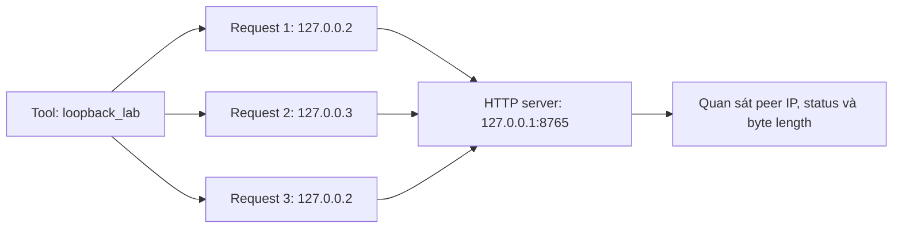

# Minh họa xoay IP nguồn trong lab localhost

Chế độ `engine="loopback_lab"` phục vụ bài thực hành: lần lượt dùng địa chỉ nguồn `127.0.0.2`, `127.0.0.3` cho các kết nối HTTP đến server trên cùng máy. Địa chỉ nguồn được bind vào socket thật. Máy chủ có thể quan sát địa chỉ peer; status, số byte body và thời gian đều được đo từ request thật.

Đây là các địa chỉ loopback trong máy, không tạo IP Internet mới. Chế độ này chỉ nhận target loopback và không kết nối tới `cab.vn` hoặc hệ thống bên ngoài.



## Chạy thử trên Windows

Mở hai terminal tại thư mục dự án. Gọi Python trực tiếp trong `.venv` để không phụ thuộc quyền chạy `Activate.ps1`.

Terminal 1 tạo một website lab nhỏ rồi chạy server chỉ trên loopback:

```powershell
New-Item -ItemType Directory -Force output_samples\loopback_lab_site | Out-Null
Set-Content output_samples\loopback_lab_site\first.txt "first local response" -Encoding UTF8
Set-Content output_samples\loopback_lab_site\second.txt "second local response" -Encoding UTF8
Set-Content output_samples\loopback_lab_site\third.txt "third local response" -Encoding UTF8
.\.venv\Scripts\python.exe -B -m http.server 8765 --bind 127.0.0.1 --directory output_samples\loopback_lab_site
```

Terminal 2 gọi agent hiện có với chế độ lab:

```powershell
@'
import json
from src.agents.fuzzer import FuzzingAgent

result = FuzzingAgent(llm=None).execute(
    target_url="http://127.0.0.1:8765",
    wordlist=["first.txt", "second.txt", "third.txt"],
    use_pattern_engine=False,
    engine="loopback_lab",
    lab_source_ips=["127.0.0.2", "127.0.0.3"],
    max_requests=3,
    rate_limit=2,
)
print(json.dumps(result, ensure_ascii=False, indent=2))
'@ | .\.venv\Scripts\python.exe -B -
```

Server ở terminal 1 sẽ ghi địa chỉ peer. Đối chiếu thứ tự này với `bound_source_ip` trong kết quả: `.2`, `.3`, `.2`. `selected_source_ip` là địa chỉ được chọn để bind; `bound_source_ip` là địa chỉ socket thực tế sau khi kết nối. Nếu bind hoặc kết nối thất bại, kết quả ghi lỗi; không tạo giá trị đo giả.

## Phạm vi và điều kiện dừng

- Target chỉ nhận `127.0.0.1`, `::1`, hoặc `localhost` được chuẩn hóa về `127.0.0.1`; không phân giải hostname bên ngoài.
- `lab_source_ips` chỉ gồm 1–8 địa chỉ loopback cùng họ IP với target và chỉ dùng cùng `engine="loopback_lab"`.
- Không dùng proxy, giả mạo header IP, theo redirect hoặc quét đệ quy.
- Gửi tuần tự: mặc định 4 request, tối đa 100; mặc định 2 request/giây, tối đa 10; timeout tối đa 10 giây, ngân sách phiên tối đa 60 giây. Ngân sách được kiểm tra quanh thao tác socket; server gửi nhỏ giọt header có thể khiến thời gian thực vượt ngân sách.
- Gặp HTTP 429 sẽ dừng toàn phiên trước khi dùng địa chỉ nguồn tiếp theo. Nhiều 403 liên tiếp cũng dừng toàn phiên. Xoay địa chỉ trong lab không được dùng để tiếp tục sau khi bị chặn.
- Các backend `ffuf_cli` và `python_http` giữ nguyên hành vi proxy cố định. Kiểm thử qua các tuyến proxy được cấu hình trước dùng chế độ riêng [proxy_http](proxy_http_authorized_testing.md), với danh sách origin cho phép và điều kiện dừng toàn phiên.

## Dùng trong tiểu luận

Lưu cấu hình lab, log peer IP trên server, JSON kết quả và số lượng request server nhận được. Phân biệt rõ IP loopback của thí nghiệm với địa chỉ egress công cộng. HTTP 200 và thay đổi IP nguồn không phải bằng chứng phát hiện lỗ hổng hoặc vượt chặn.

Chạy các test cho thí nghiệm và tích hợp:

```powershell
.\.venv\Scripts\python.exe -B -m unittest discover -s tests -p "test_loopback*.py" -v
```
